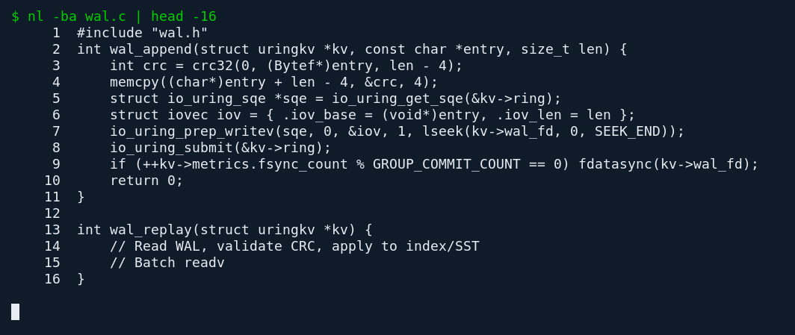
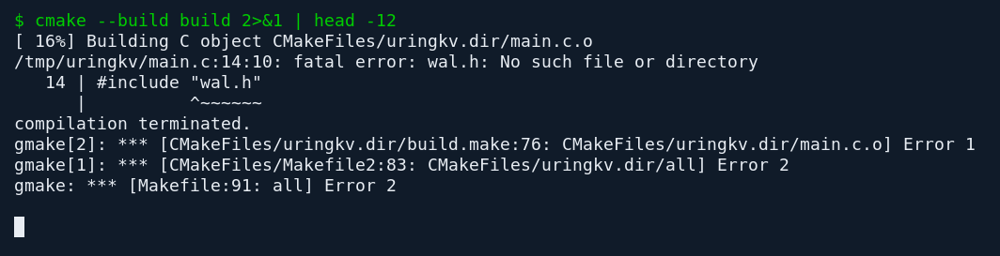

# uringKV

В архиве представлены исходники эксперимента с журналом предзаписи, индексом, SST и измерением задержек. В main.c описаны команды put, get, del, scan и bench. Восстановление журнала и компактация оставлены в виде заготовок.



*Функция записи через io_uring*



*Остановка сборки на отсутствующем заголовке wal.h*

## Запуск

Для воспроизведения сборки требуются Linux, CMake, компилятор C, pkg-config, liburing и zlib с заголовками.

```bash
cmake -S . -B build
cmake --build build
```

## Что проверено

В Debian CMake нашёл зависимости. Компиляция остановилась на wal.h. В переданном архиве также отсутствуют sst.h, index.h и metrics.h. Готового исполняемого файла в этой версии нет.

## Авторство

Вячеслав Георгиевич Кузнецов. Сбертех, задание 2.
